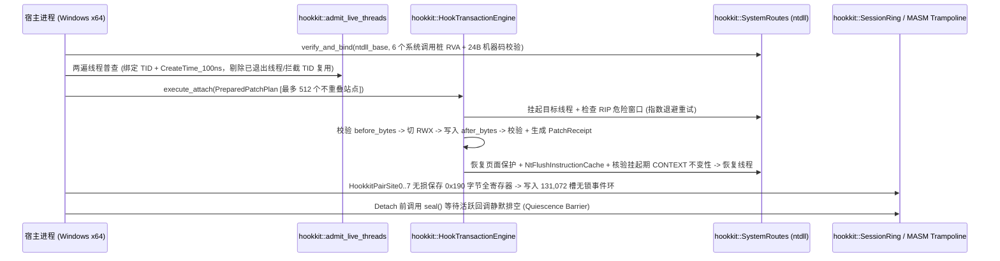

<div align="center">

# W I N 6 4 - H O O K K I T

**Windows x64 事务型运行时指令插桩、动态线程池准入、进程内闭合世界单步沙盒与 PE32+ 二进制分析引擎**  
*Transactional Windows x64 Runtime Instrumentation, Live Thread Admission, Closed-World Hardware Sandbox & PE32+ Analysis Suite*

[-00599C?style=flat-square&logo=c%2B%2B&logoColor=white)](#)
[](#)
[-0078D6?style=flat-square&logo=windows&logoColor=white)](#)
[](#)
[-6e7681?style=flat-square)](#maintenance)
[](LICENSE)

[**简体中文**](#zh) · [**English**](#en) · [**Русский**](#ru) · [**日本語**](#ja)

</div>

---

<a id="zh"></a>

## 项目概览

**win64-hookkit** 是一套面向 Windows x64 的底层系统工程工具集，由 **C++17 + MASM (`ml64`) 事务型运行时插桩静态库 (`hookkit`)** 与 **Python 进程内闭合世界（Closed-World）原生 CPU 单步沙盒、Minidump 原址映射及 PE32+ 静态控制流审计套件** 组成。

在高并发多线程原生程序中，常规 Inline Hook 框架极易遭遇四类底层竞态：
1. 工作线程池在 Attach 与 Detach 之间动态创建或销毁线程（以及操作系统 TID 复用）；
2. 目标线程指令指针（`RIP`）恰好停留在补丁窗口或跳板（Trampoline）危险区内；
3. 操作中途页面权限恢复失败或外部监控进程崩溃，留下半截机器码导致宿主崩溃；
4. 离线复现二进制函数时，软件模拟器（如 Unicorn/QEMU）无法 100% 还原真实 x64 硬件的 SIMD/FMA/x87/MXCSR 与 NaN 负载位行为。

**win64-hookkit** 将运行时插桩建模为**可形式化验证的原子事务（支持逆序回滚与 8 种确定性故障注入）**，并提供直接在真实 x64 CPU 硬件上单步执行 PE32+ 函数的**闭合世界内存边界沙盒**。

<a id="maintenance"></a>

> [!NOTE]
> **维护状态声明（As-Is Archival Code Drop）**  
> 本仓库是从已完结研发工程中通用化拆出的**独立技术开源快照**。所有 C++17/MASM 组件与 Python 工具链均已完成闭环编译与单测验证。**作者不计划提供后续更新维护、功能开发、Issue 答疑或 PR 审查**。代码基于 [MIT License](LICENSE) 按“原样（As-Is）”开放，欢迎自由 Fork、裁剪或直接内嵌到你的项目中。



---

## 核心架构与组件矩阵

### 1. C++17 + MASM 事务型运行时库 (`include/hookkit/`, `src/`)

| 头文件 / 实现 | 系统工程能力 | 关键原语 |
| :--- | :--- | :--- |
| **`hookkit/patch_core.h`**<br/>`src/patch_core.inc` | **不重叠补丁规划与原子逆序回滚**<br/>校验最多 `512` 个并发补丁目标的地址区间不相交性，捕获 32 字节 `before_bytes` / `after_bytes` 计划并支持确定性逆序回滚。 | `targets_are_disjoint()`<br/>`apply_plan_bytes()`<br/>`rollback_plan_bytes()` |
| **`hookkit/hook_transaction.h`**<br/>`src/hook_transaction.cpp` | **两阶段停线程事务引擎（含 8 模式故障注入）**<br/>当任意线程 `RIP` 落入补丁或跳板窗口时自动退避重试；Detach 时等待回调静默；比对挂起首尾线程 `CONTEXT` 防止外部篡改；内置 8 种故障注入模式验证回滚路径。 | `HookTransactionEngine`<br/>`FaultInjectionMode`<br/>`IPlatformHookOps` |
| **`hookkit/thread_admission.h`**<br/>`src/thread_admission.cpp` | **动态线程池身份准入与防 TID 复用**<br/>绑定 `(ThreadId, CreateTime_100ns)` 唯一身份标识，自动将正常退出的工作线程标记为 Dead，拒绝操作系统 TID 复用导致的跨线程误操作，配合两遍普查确保线程集合一致。 | `admit_live_threads()`<br/>`verify_two_pass_census_equal()` |
| **`hookkit/system_routes.h`**<br/>`src/system_routes.cpp` | **`ntdll` 系统调用桩直连校验与 8192 槽调用账本**<br/>绑定前对 `NtSuspendThread`、`NtResumeThread`、`NtGetContextThread`、`NtQueryInformationThread`、`NtProtectVirtualMemory`、`NtFlushInstructionCache` 执行 RVA 与前 24 字节机器码双重校验。 | `SystemRoutes::verify_and_bind()`<br/>`SystemCallLedgerEntry` |
| **`hookkit/context_capture.h`**<br/>`src/context_trampoline_x64.asm` | **x64 MASM 全寄存器无损跳板（`0x190` 字节快照）**<br/>手写 `ml64` 汇编跳板（含 `.allocstack`/`.endprolog` SEH 展开信息），在进入 C++ 回调前无损保存 15 个通用寄存器、`XMM0–XMM15`、`RFLAGS`、`RSP`、`MXCSR` 与 x87 FPU 控制字。 | `CapturedRegisters` (`0x190`)<br/>`HookkitPairSite0..7`<br/>`HookkitEntrySite0..7` |
| **`hookkit/session_ring.h`**<br/>`src/session_ring.cpp` | **131,072 槽无锁事件环与动态卸载静默排空屏障**<br/>基于 `std::atomic` 发布序号的 `131,072` 槽无锁事件环、`4,096` 槽线程通知环、`enter_spawn()` 辅助线程互斥门，以及确保零线程滞留回调内的 `seal()` 静默屏障。 | `SessionRing`<br/>`enter_spawn()` / `seal()`<br/>`CallbackScope` |
| **`hookkit/patch_receipt.h`**<br/>`src/patch_receipt.cpp` | **SEH 保护补丁证人收据（Witness Receipt）**<br/>在安装与卸载前后以 SEH 保护方式快照目标字节、跳板内存与页面保护属性，计算 CRC-32 并支持二进制/JSON 双格式落盘审计。 | `PatchReceipt`<br/>`TargetPatchRecord` |
| **`hookkit/int3_guard.h`**<br/>`src/int3_guard.cpp` | **全指令 `INT3` 覆盖、EFLAGS 算术仿真与孤儿会话自愈守卫**<br/>将整条目标指令全部填为 `0xCC`（防止外部控制器崩溃后内核在 `site+1` 恢复线程跳入半条指令中间），精确仿真 `CF/PF/AF/ZF/SF/OF`，并在外部监控进程意外退出时自动挂起宿主线程、拨回 `RIP`、还原机器码并恢复运行。 | `install_full_int3_overlay()`<br/>`emulate_add_flags()`<br/>`OrphanSelfHealGuard` |
| **`hookkit/health.h`**<br/>`src/health.cpp` | **无锁 Seqlock 跨进程遥测块 (`HKIT_H01`)**<br/>通过原子顺序锁向外发布事务状态、高精度 `QPC` 时间戳与回调进出计数，无需加锁即可供外部进程只读诊断。 | `SeqlockHealthBlock::publish()`<br/>`read_consistent()` |

### 2. Python 闭合世界硬件单步沙盒与 PE32+ 分析套件 (`tools/`)

| 工具脚本 | 用途 | 核心特性 |
| :--- | :--- | :--- |
| **`tools/closed_replay.py`** | **进程内 x64 闭合世界硬件单步沙盒与写断点监视器** | 将 PE32+ 镜像与录制内存块通过 `VirtualAlloc` 原址映射，利用 `INT3` + `VEH` + `EFLAGS.TF` 在真实 CPU 上逐指令单步执行；执行前校验取指范围、显式内存操作数与 `rep movs`/`stos` 整段读写区间（精准区分 SSE2 `movsd` 与字符串 `movsd`）；任何越界访问在指令执行前安全拦截并完整恢复非易失 GPR + `XMM6..15` 返回 Python；附带 `PAGE_READONLY` 硬件写断点监视器 `PageWriteWatchpoint`。 |
| **`tools/pe_cfg_unwind.py`** | **PE32+ `.pdata` 异常展开链 + CFG + 静态控制流审计器** | 完整解析 AMD64 `.pdata` 与链式 `UNWIND_INFO`（`UNW_FLAG_CHAININFO` + 环路预算保护 + Handler RVA 提取），解析 Directory 10 `LoadConfig` 中的 **Control Flow Guard (CFG)** 分发槽位，结合 Capstone 对直接调用、IAT、CFG 间接调用、虚表调用与跳表做静态闭包分类。 |
| **`tools/health_observer.py`** | **跨进程只读 Seqlock 遥测读取器与防 PID 复用监护器** | 仅以 `PROCESS_QUERY_LIMITED_INFORMATION \| PROCESS_VM_READ` (`0x1010`) 只读权限打开目标进程，校验 EXE/DLL SHA-256，带撕裂读重试读取 `HKIT_H01` 遥测块，并通过进程出生 `FILETIME` 门禁防止 PID 复用竞争。 |
| **`tools/detours_prepare_only.py`** | **Prepare-Only Microsoft Detours v4.0.1 源码脱耦转换器** | 将官方 Detours v4.0.1 源码机械转换为**纯准备期跳板规划器**：剥离全部 `SuspendThread`/`ResumeThread`/`GetThreadContext`/`SetThreadContext` 与原生 Commit/Abort，注入 `patch_core.inc`，由 `hookkit::HookTransactionEngine` 独占线程挂起与事务发布。 |
| **`tools/hook_audit.py`** | **静态 DLL/Hook 站点契约核验与 `.pdata` 指针链写者扫描器** | Hook 前静态核验 DLL 导出白名单与禁止导入（如禁止 `user32.dll`），分类目标站点（`.pdata` 函数 / `rel32` 跳板 / 叶函数）并比对磁盘 PE 与 `.dmp` 字节一致性；支持在 `.pdata` 函数范围内做寄存器别名追踪，定位任意结构体偏移链（如 `[rcx+off1]+off2`）的全部写指令。 |
| **`tools/ntdll_routes.py`** | **`ntdll.dll` 系统调用桩清单生成与系统更新漂移门禁** | 提取当前系统 `ntdll.dll` 6 个核心系统调用桩的 RVA 与前 24 字节机器码生成 JSON 清单与 C++ `.inc` 头文件（`generate`），并在 Windows 更新后检测机器码漂移（`check-drift`，退出码 `0` vs `3`）。 |
| **`tools/minidump.py`** | **零拷贝全内存 Minidump (`MDMP`) 解析器** | 基于 `mmap` 解析 `Memory64ListStream` (Stream 9) 与 `MemoryInfoListStream` (Stream 16)，提供 $O(\log N)$ 二分查找虚拟地址读取。 |
| **`tools/dump_memtrace.py`** | **Minidump 64 KiB 原址重映射规划与加载器** | 按 Windows 64 KiB 分配粒度合并转储区间（`coalesce_ranges_64k`）并调用 `VirtualAlloc` 原址映射，使提取出的二进制函数可直接针对原指针图运行（配合 `closed_replay.py` 的 VEH 单步与页面写断点使用）。 |
| **`tools/pe_xref.py`** | **向量化 PE32+ 交叉引用与 MSVC x64 RTTI 扫描器** | 基于 NumPy 滑动窗口高速扫描全镜像 `RIP + disp32` 数据引用、`E8`/`E9` 直接分支目标以及 64 位 MSVC `TypeDescriptor` (`.?AV` / `.?AU`) 符号，无需启动 IDA 或 Ghidra。 |

---

## 快速构建与验证

### 1. 编译 C++17 + MASM 静态库 (`hookkit`) 与原生测试套件 (`hookkit_test`)

```bash
cmake -B build -S .
cmake --build build --config Release
./build/Release/hookkit_test
```

> 可选 CMake 开关：`-DHOOKKIT_WITH_MASM=ON`（默认开启，使用 `ml64` 编译 `context_trampoline_x64.asm`）、`-DHOOKKIT_WITH_DETOURS=OFF`、`-DHOOKKIT_BUILD_TESTS=ON`。

### 2. 运行 Python 工具链与实机沙盒单测套件（16 项全量测试）

```bash
pip install -r requirements-dev.txt
python -B -m unittest discover -s tests -v
```

### 3. 生成并校验本机 `ntdll.dll` 系统调用桩漂移

```bash
# 1. 冻结当前主机 ntdll.dll 6 个系统调用桩并生成 C++ 头文件
python tools/ntdll_routes.py generate \
    --manifest-out build/ntdll_routes.json \
    --cpp-inc-out build/system_routes.inc

# 2. 校验当前系统 ntdll.dll 是否发生机器码漂移（0 = 无漂移，3 = 检测到漂移）
python tools/ntdll_routes.py check-drift --manifest build/ntdll_routes.json
```

---

<a id="en"></a>

## English Documentation

**win64-hookkit** is a low-level Windows x64 systems engineering toolkit combining a **transactional C++17 + MASM (`ml64`) inline-patching, context-capture & thread-admission runtime (`hookkit`)** with an **in-process closed-world x64 hardware single-step sandbox, zero-copy Minidump mapper, and PE32+ static analysis suite**.

> [!NOTE]
> **Maintenance Policy (As-Is Archival Release)**  
> This repository is a self-contained technical code drop extracted from a completed R&D project. All C++17/MASM libraries and Python test suites are verified and passing. **The author does not plan to provide ongoing maintenance, issue triage, or PR reviews.** Released "as-is" under the [MIT License](LICENSE)—feel free to fork, vendor, or adapt it.

### Key Highlights
- **Two-Phase Stopped-Thread Transaction Engine (`hookkit::HookTransactionEngine` & `patch_core`)**: Validates up to 512 disjoint patch targets, backs off exponentially if any thread's `RIP` lies inside a patch/trampoline hazard window, waits for callback quiescence on detach, verifies `CONTEXT` immutability while suspended, and includes **8 deterministic fault-injection modes** with full reverse-order rollback.
- **Dynamic Thread-Pool Admission & Direct `ntdll` Syscall Verification (`thread_admission` & `system_routes`)**: Binds `(ThreadId, CreateTime_100ns)` identities to safely retire exited worker threads while blocking OS TID-recycling races; verifies RVA + 24 machine bytes of 6 core `ntdll.dll` syscall stubs before binding and logs calls to an 8192-slot ring ledger.
- **Lossless `0x190`-Byte MASM Trampoline, 131k Lock-Free Ring & Self-Healing `INT3` Guard (`context_trampoline_x64.asm`, `session_ring`, `patch_receipt`, `int3_guard`)**: Preserves all 15 GPRs, `XMM0–XMM15`, `RFLAGS`, `RSP`, `MXCSR`, and x87 FPU CW; provides a 131,072-slot atomic event ring with `seal()` drain barrier, SEH-guarded patch witness receipts, full-instruction `0xCC` overlays, EFLAGS arithmetic emulation, and an orphan monitor thread that automatically rewinds trapped `RIP`s and restores original code if an external controller process dies.
- **In-Process Closed-World x64 Hardware Sandbox & PE32+ Auditors (`closed_replay.py`, `pe_cfg_unwind.py`, `health_observer.py`, `detours_prepare_only.py`, `hook_audit.py`)**: Maps PE32+ images and memory blocks in-place and single-steps functions on real x64 CPU hardware via `INT3` + `VEH` + `EFLAGS.TF`, enforcing pre-execution read/write span containment (including full `rep movs`/`stos` range checks and SSE2 `movsd` disambiguation) with crash-free non-volatile register abort recovery and `PAGE_READONLY` write watchpoints.

---

<a id="ru"></a>

## Документация на русском

**win64-hookkit** — это низкоуровневый системный инструментарий для Windows x64, объединяющий **транзакционную среду выполнения C++17 + MASM (`ml64`) для перехвата функций и управления потоками (`hookkit`)** с **внутрипроцессной песочницей пошагового выполнения на реальном CPU, маппером полных дампов памяти (`MDMP`) и пакетом статического анализа PE32+**.

> [!NOTE]
> **Статус поддержки (As-Is / Архивный релиз)**  
> Данный репозиторий представляет собой завершённый технический релиз (code drop), выделенный из закрытого исследовательского проекта. Все компоненты C++17/MASM и тесты полностью работоспособны. **Автор не планирует активно поддерживать репозиторий, отвечать на Issues или принимать PR.** Код предоставляется «как есть» (As-Is) под лицензией [MIT](LICENSE) — вы можете свободно форкать и встраивать его в свои проекты.

### Основные возможности
- **Транзакционный движок перехвата с инъекцией сбоев (`hookkit::HookTransactionEngine`, `patch_core`)**: Атомарная установка до 512 непересекающихся патчей с проверкой опасных зон `RIP`, ожиданием завершения активных колбэков при выгрузке, контролем неизменности `CONTEXT` приостановленных потоков, 8 режимами инъекции ошибок и полным обратным откатом.
- **Допуск динамических пулов потоков и верификация стабов `ntdll.dll` (`thread_admission`, `system_routes`, `ntdll_routes.py`)**: Идентификация потоков по паре `(ThreadId, CreateTime_100ns)` защищает от гонок при переиспользовании TID операционной системой; прямая проверка RVA и первых 24 байт машинного кода 6 системных вызовов `ntdll` с кольцевым журналом на 8192 записи.
- **MASM-трамплин без потери регистров (`0x190` байт), кольцо событий на 131 072 слота и самовосстанавливающийся `INT3`-страж (`context_trampoline_x64.asm`, `session_ring`, `patch_receipt`, `int3_guard`)**: Полное сохранение 15 GPR, `XMM0–XMM15`, `RFLAGS`, `RSP`, `MXCSR` и FPU CW; барьер дренирования `seal()`; криптографические квитанции патчей (`PatchReceipt`); заполнение всей инструкции байтами `0xCC` с эмуляцией `EFLAGS` и автоматическим откатом `RIP` / восстановлением кода при аварийном завершении внешнего процесса-наблюдателя.
- **Аппаратная песочница замкнутого мира и аудит PE32+ (`closed_replay.py`, `pe_cfg_unwind.py`, `health_observer.py`, `detours_prepare_only.py`, `hook_audit.py`)**: Выполнение функций PE32+ по исходным виртуальным адресам на реальном процессоре через `INT3` + `VEH` + `EFLAGS.TF` с предвычислительной проверкой всех операндов памяти и строковых инструкций `rep movs`/`stos` (с точным отделением SSE2 `movsd`), безопасным возвратом в Python при нарушении границ, точками наблюдения записи `PAGE_READONLY`, анализом цепочек `.pdata` / `UNWIND_INFO` / CFG и генератором Prepare-Only Detours v4.0.1.

---

<a id="ja"></a>

## 日本語ドキュメント

**win64-hookkit** は、Windows x64 環境向けの**トランザクショナル C++17 + MASM (`ml64`) ランタイム・インストルメンテーション＆動的スレッドアドミッション・エンジン (`hookkit`)** と、**インプロセス閉世界（Closed-World）ハードウェア単歩サンドボックス・Minidump インプレースマッパー・PE32+ 静的解析スイート**を統合した低レイヤ・システムエンジニアリング・ツールキットです。

> [!NOTE]
> **メンテナンス方針（現状渡し / アーカイブ公開）**  
> 本リポジトリは完了した研究開発プロジェクトから汎用コンポーネントを抽出・公開したコードドロップです。全 C++17/MASM ライブラリおよび単体テストは検証済みですが、**今後の継続的なメンテナンスや Issue / PR 対応は予定していません**。[MIT License](LICENSE) の下で現状渡し（As-Is）として公開されており、自由なフォークや組み込みが可能です。

### 主な機能
- **2フェーズ停止トランザクション＆フォールト注入 (`hookkit::HookTransactionEngine`)**：最大 512 個の非重複パッチターゲットを同時に処理。スレッドの `RIP` が危険領域内にある場合の自動バックオフ再試行、Detach 時のコールバック静止待機、停止中の `CONTEXT` 改ざん検知、8 種類の故障注入モードと逆順ロールバックを備えます。
- **動的スレッドプール准入＆`ntdll` システムコール検証 (`thread_admission` / `system_routes`)**：`(ThreadId, CreateTime_100ns)` によるスレッド同一性追跡で TID 再利用競合を遮断し、6 つの主要 `ntdll` システムコールスタブの RVA と先頭 24 バイト機械語を検証します。
- **全レジスタ無損失 MASM トランポリン・131k ロックフリーリング・自己修復 `INT3` ガード (`context_trampoline_x64.asm` / `session_ring` / `patch_receipt` / `int3_guard`)**：15 GPR・`XMM0–15`・`RFLAGS`・`MXCSR`・FPU 制御語（計 `0x190` バイト）の無損失保存、`seal()` ドレインバリア、パッチ証人レシート、全命令長 `0xCC` 充填＋外部監視プロセス異常終了時の自動 `RIP` 巻き戻しと機械語復元を提供します。
- **インプロセス閉世界ハードウェア単歩サンドボックス＆PE32+ 監査スイート (`closed_replay.py` / `pe_cfg_unwind.py` / `health_observer.py` / `detours_prepare_only.py` / `hook_audit.py`)**：`VEH`＋`EFLAGS.TF` により実 CPU 上で PE32+ 関数を単歩実行し、全メモリオペランドおよび `rep movs`/`stos` の読み書き範囲を実行前に検証（違反時は非揮発レジスタを復元して安全に中断）。さらにチェーン `.pdata` 展開・CFG 監査・プロセス外 Seqlock 監視・Prepare-Only Detours 変換を提供します。

---

## License

Released under the [MIT License](LICENSE).
